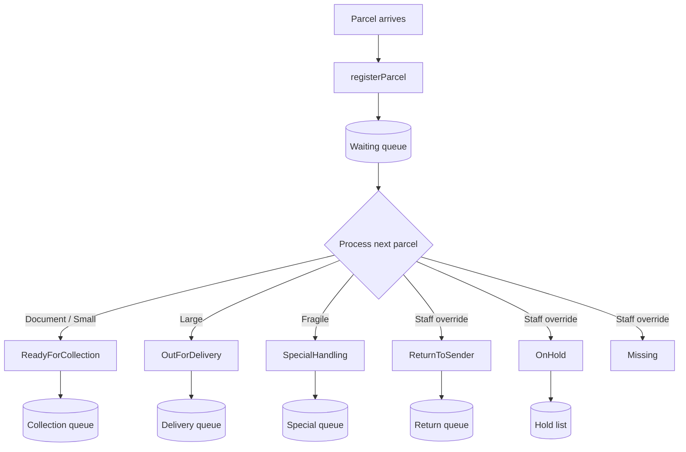

# Parcel Routing Rules and Workflow

**Module:** Task 1 – Parcel Intake, Sorting and Processing
**Owner:** [Name, TP number]
**Status:** PROPOSAL – every teammate should read this and confirm or suggest changes before the code depends on it.

This document explains how a parcel moves through the system after it is registered, so that every module (Tasks 2 to 5) knows what to expect from Task 1.

---

## 1. Overview

1. A parcel is **registered** and gets the status `Registered`.
2. It joins the **waiting queue** (first in, first out).
3. Staff **process the next parcel**. The system picks a **default route** from the parcel type, or staff **override** it.
4. The parcel's status is updated and it moves into the **destination queue** for that route.
5. Later modules (service requests, resources, history) take over from the destination queues.

---

## 2. Routing rule

### Layer 1: automatic default (from the parcel type)

| Parcel type | Default new status | Destination queue |
|---|---|---|
| Document | `ReadyForCollection` | collection |
| Small | `ReadyForCollection` | collection |
| Large | `OutForDelivery` | delivery |
| Fragile | `SpecialHandling` | special |

**Why:** most parcels need no decision. Small items can be collected at a counter, large items are easier to deliver, and fragile items need extra care.

### Layer 2: staff override

Staff can choose a different route when the system cannot know the situation:

| Staff choice | New status | Typical reason |
|---|---|---|
| Return to sender | `ReturnToSender` | wrong or unreachable address, refused parcel |
| Hold for investigation | `OnHold` | damaged parcel, unclear recipient |
| Report missing | `Missing` | parcel cannot be found |

**Why:** these cases depend on information that is not stored in the parcel record.

---

## 3. Status transition rules

Every status change must be checked with `canTransition(from, to)` (in `Status.hpp` / `Status.cpp`). **No module changes a status directly without calling it.**

| From | Allowed next |
|---|---|
| `Registered` | `ReadyForCollection`, `OutForDelivery`, `SpecialHandling`, `ReturnToSender`, `OnHold`, `Missing` |
| `SpecialHandling` | `ReadyForCollection`, `OutForDelivery`, `ReturnToSender`, `OnHold` |
| `OnHold` | `Registered`, `ReturnToSender`, `Missing`, `Cancelled` |
| `ReadyForCollection` | `Collected`, `ReturnToSender`, `Missing` |
| `OutForDelivery` | `Delivered`, `ReturnToSender`, `Missing` |
| `ReturnToSender` | `Returned` |
| `Missing` | `OnHold`, `Cancelled` |
| `Collected`, `Delivered`, `Returned`, `Cancelled` | none (final states) |

`isFinalStatus(s)` returns true for the last row. A final parcel can never be processed again.

---

## 4. Queues owned by the registry

All queues hold **pointers** to parcels. The registry owns the parcel objects, and queues never delete them.

| Queue | Holds parcels with status | Used by |
|---|---|---|
| `waiting` | `Registered` | Task 1 (routing) |
| `collectionQueue` | `ReadyForCollection` | Tasks 2 and 3 |
| `deliveryQueue` | `OutForDelivery` | Tasks 2 and 3 |
| `specialQueue` | `SpecialHandling` | Tasks 2 and 3 |
| `returnQueue` | `ReturnToSender` | Tasks 2 and 3 |
| `holdQueue` | `OnHold` | Task 1 (investigation) |

---

## 5. How `routeNextParcel` works

1. If the waiting queue is empty, return `Empty`.
2. **Peek** at the first parcel (do not remove it yet).
3. If the parcel is already in a final status, return `AlreadyCompleted`.
4. Work out the new status (default by type, or the staff override).
5. If `canTransition(current, new)` is false, return `InvalidStatus`. The parcel stays at the front of the queue.
6. Only now: remove it from `waiting`, set its status, and add it to the matching destination queue.
7. Return `Success`.

**Rule:** validate everything first, then change anything. A failed operation must leave the system unchanged.

---

## 6. Exceptions handled by this module

| Situation | Result code |
|---|---|
| Processing when no parcels are waiting | `Empty` |
| Parcel ID not found | `NotFound` |
| Duplicate parcel ID at registration | `Duplicate` |
| Missing or blank fields at registration | `InvalidInput` |
| Trying to process a completed parcel | `AlreadyCompleted` |
| Status change not allowed by the table | `InvalidStatus` |
| Parcel reported missing | handled as the `Missing` route |

---

## 7. What other modules can rely on

- A parcel's **single real record** lives in the registry. Other modules store the **Parcel ID** (or a pointer), never a copy.
- When a request or resource is linked to a parcel, the controller fills `parcel.requestID` and `parcel.resourceID`.
- Other modules must **not** edit `parcel.status` themselves. They ask Task 1 (`updateParcelStatus`), which checks `canTransition`.
- Every status change should be reported to Task 4 (activity history) so it can be undone later. Task 4 will need the **previous status**.

---

## 8. Open questions for the team

Please answer these in a comment or at the next meeting:

- [ ] Do you agree with the default route by parcel type (section 2)?
- [ ] Which routes need a **service request** (Task 2)? Proposal: delivery, special handling and return. Collection only needs a counter.
- [ ] Should the hold queue be processed in order, or searched by ID?
- [ ] What should Task 4 store so an undo can restore the old status?
- [ ] Are the queue names in section 4 fine for everyone?

---

## 9. Files involved

| File | Purpose |
|---|---|
| `include/Parcel.hpp` | `Parcel` struct, `ParcelType` |
| `include/Status.hpp`, `src/Status.cpp` | status enum, `canTransition`, `isFinalStatus`, `statusToString` |
| `include/ParcelQueue.hpp`, `src/ParcelQueue.cpp` | linked list queue |
| `include/ParcelRegistry.hpp`, `src/ParcelRegistry.cpp` | registry, registration, display, routing |
| `include/Interfaces.hpp` | function names shared between modules |
