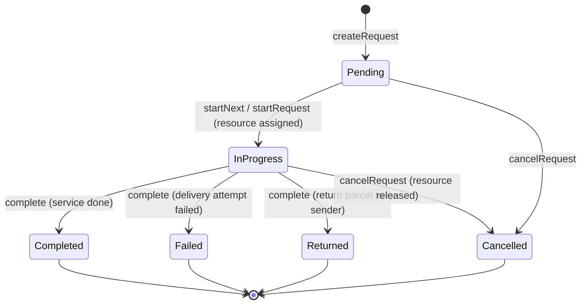

# Service Request Rules and Workflow

**Module:** Task 2 – Parcel Service and Collection Management
**Owner:** [Name, TP number]

This document explains how service requests are created, ordered, processed and closed, and why the data structure and priority rule were chosen.

---

## 1. Files

| File | Purpose |
|---|---|
| `include/ServiceRequest.hpp`, `src/ServiceRequest.cpp` | `ServiceRequest` record, enums, **priority rule** (`hasHigherPriority`), messages |
| `include/RequestPriorityList.hpp`, `src/RequestPriorityList.cpp` | **sorted singly linked list** used as the priority queue |
| `include/ServiceManager.hpp`, `src/ServiceManager.cpp` | create / start / complete / cancel, integration with Tasks 1, 3 and 4 |
| `tests/service_test.cpp` | automated tests (`service_tests` target) |
| `src/main.cpp` | menu option **13. Service requests** |

---

## 2. Data structures

| Structure | Holds | Why |
|---|---|---|
| **Sorted singly linked list** (`RequestPriorityList`) | pointers to **Pending** requests, highest priority at the head | It is a priority queue: the next request to handle is always the head (`peek` O(1), `removeFront` O(1)). |
| Singly linked **record list** (head + tail) in `ServiceManager` | **every** request ever created, oldest first | Owns the requests; keeps closed ones for the record; append is O(1) with the tail pointer. |

### Why a sorted linked list?

| Operation | Sorted linked list | Unsorted list | Array / binary heap |
|---|---|---|---|
| Insert | O(n) — walk to position | O(1) | O(log n) |
| Get / remove next | **O(1)** — the head | O(n) search | O(log n) |
| Cancel / start a selected request (remove by ID) | O(n), simple unlink | O(n) | O(n) search + re-heapify |
| Show requests in priority order | **O(n)** — just walk the list | O(n²) / sort first | needs a sort / copy |
| Size limit | none (dynamic nodes) | none | fixed capacity or resize |
| Ties (equal priority) | **stable**: equal requests keep arrival order | – | heap is not stable; needs extra key |

- Staff constantly need to **see the waiting requests in the order they will be handled**. The sorted list gives that for free.
- Requests are **cancelled or picked out of order** (remove from the middle). In a linked list that is just relinking pointers.
- The campus parcel desk handles tens to hundreds of active requests, so O(n) insert is cheap. The simpler code is easier to verify.
- **Limitation:** with thousands of requests a binary heap would insert faster (O(log n)). This trade-off was accepted for the clarity, ordered display and stable ties above.

### Insert algorithm (stable)

```
insert(r):
    if list empty OR r beats head:   r becomes the new head
    else:
        current = head
        while current.next exists AND NOT (r beats current.next):
            current = current.next
        link r after current
```

The loop stops only at a node with **strictly lower** priority. So a new request goes **after** all requests of equal priority, and first come, first served holds for ties.

---

## 3. Priority rule (requirement 3)

`hasHigherPriority(a, b)` compares in this order:

1. **Urgency:** `Urgent` before `Normal`.
2. **Service type rank:**

| Rank | Service | Reason |
|---|---|---|
| 1 | Special Handling | fragile/special parcels are at risk while they wait |
| 2 | Re-delivery | the recipient has already been let down once |
| 3 | Campus Delivery | a courier trip has to be planned |
| 4 | Return to Sender | no recipient on campus is waiting for it |
| 5 | Collection | the parcel waits safely at the counter until the recipient comes; if someone is standing at the counter, staff mark it **Urgent** |

3. **Request order (tie-break):** the lower `sequenceNo` (created earlier) goes first.

**Equivalent processing conditions:** two requests with the same urgency and type are ordered by `sequenceNo`, not by clock time. Clock time has one-second resolution, so two requests can share a time, but they never share a sequence number. The order is therefore always well defined.

---

## 4. Request life cycle



`Completed`, `Failed`, `Returned` and `Cancelled` are **closed**. A closed request can never be started, completed or cancelled again.

### Service type must match the parcel's route (Task 1)

| Service | Parcel status needed | Resource (Task 3) | On completion the parcel becomes |
|---|---|---|---|
| Collection | Ready for Collection | Collection Counter | Collected (collector ID checked) |
| Campus Delivery | Out for Delivery | Delivery Personnel | Delivered (receiver ID checked) |
| Re-delivery | Out for Delivery + a failed attempt | Delivery Personnel | Delivered (receiver ID checked) |
| Special Handling | Special Handling | Delivery Personnel | Ready for Collection **or** Out for Delivery (staff choose); a follow-up Collection/Delivery request is created |
| Return to Sender | Return to Sender | Delivery Personnel | Returned |

### Outcomes when completing

| Outcome | Allowed for | Result |
|---|---|---|
| Service completed | all | as in the table above |
| Delivery attempt failed | Campus Delivery, Re-delivery | request `Failed`; a **Re-delivery** request (attempt + 1) is created. After **3** attempts (`MAX_DELIVERY_ATTEMPTS`) the parcel goes to Return to Sender and a **Return** request is created instead |
| Return parcel to sender | all except Return to Sender | request `Returned`; parcel to Return to Sender; a **Return** request is created |

---

## 5. Integration

| Step | Module | What happens |
|---|---|---|
| Create | Task 1 | parcel must exist, not be final, match the service; `parcel.requestID` is set |
| Start | Task 3 | `assignNextAvailable` takes the next free resource of the right type (round robin); request becomes In Progress |
| Complete / cancel | Task 3 | the resource is released and goes to the back of its queue |
| Complete | Task 1 | parcel status changes **only** through `updateParcelStatus` (which calls `canTransition`) |
| Every change | Task 4 | resource assigned / released and parcel status changes are recorded, so they appear in the history |
| Remove parcel | Task 1 | refused while `parcel.requestID` is set (an active request exists) |

The parcel's `resourceID` is the **single source of truth** for who is handling a request. Task 3 may hand the job to another courier when one becomes unavailable, and Task 4 may undo an assignment, so the request never stores its own copy of the current resource.

**Rule:** every operation validates everything first and only then changes anything. A failed operation leaves the system unchanged.

---

## 6. Exceptions handled (requirement 5)

| Situation | Result code |
|---|---|
| Starting when no requests are pending | `Empty` |
| Blank request ID / parcel ID / recipient ID | `InvalidInput` |
| Request ID or Parcel ID does not exist | `NotFound` |
| Parcel already has an active request | `Duplicate` |
| Recipient ID at creation, or collector/receiver ID at completion, does not match | `WrongRecipient` |
| Service does not match the parcel's route (incl. re-delivery without a failed attempt, or parcel re-routed/marked missing since) | `ServiceMismatch` |
| Starting / completing / cancelling a cancelled request | `RequestCancelled` |
| Processing a completed (or failed/returned) request, or a request for a completed parcel | `AlreadyCompleted` |
| Completing a request that was not started; starting one already in progress; invalid outcome (e.g. "failed delivery" on a collection) | `InvalidStatus` |
| No counter / courier free | `AllResourcesOccupied` / `NoResourceAvailable` (from Task 3; the request keeps its place) |
| Resource lost mid-job (became unavailable, nobody free) | complete gives `NotAssigned`; **Start / resume** the request to assign a new resource |

---

## 7. Building and testing

```
g++ -std=c++1z -Iinclude src/*.cpp -o parcels
g++ -std=c++1z -Iinclude tests/service_test.cpp src/ServiceRequest.cpp src/RequestPriorityList.cpp \
    src/ServiceManager.cpp src/Activity.cpp src/ActivityStack.cpp src/ActivityHistory.cpp \
    src/Resource.cpp src/ResourceQueue.cpp src/ResourceManager.cpp src/ParcelQueue.cpp \
    src/ParcelRegistry.cpp src/Status.cpp -o service_tests
```

Or with CMake: targets `parcels` and `service_tests`.
